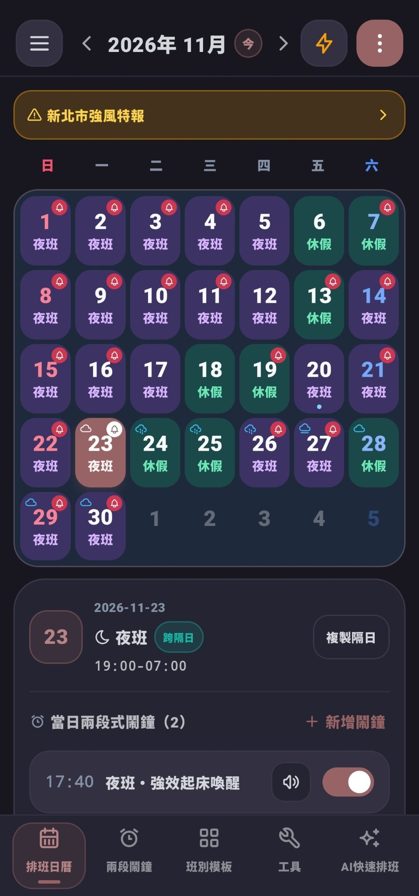
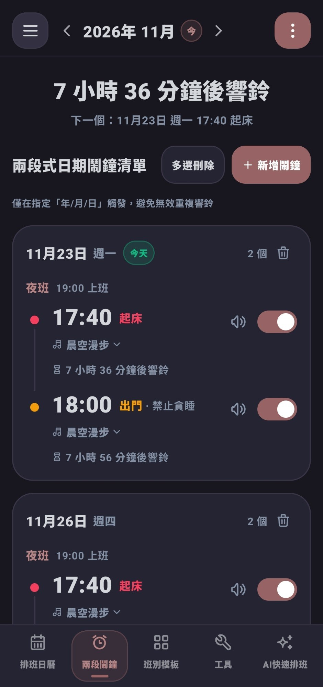
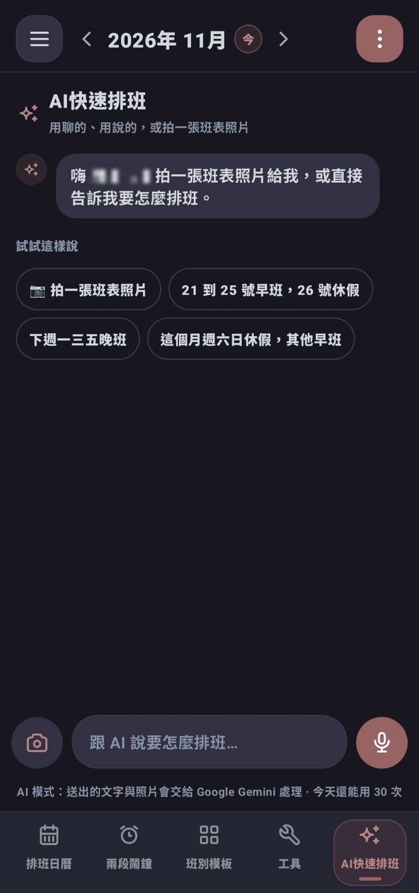
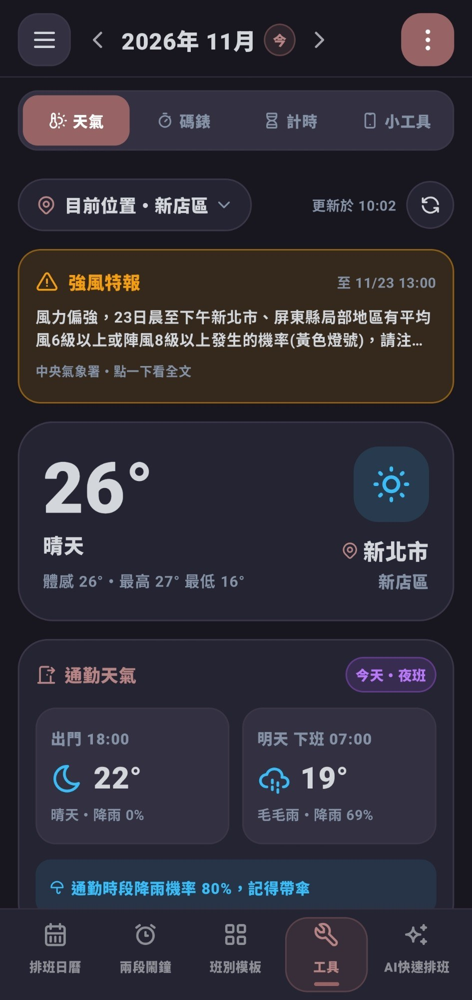
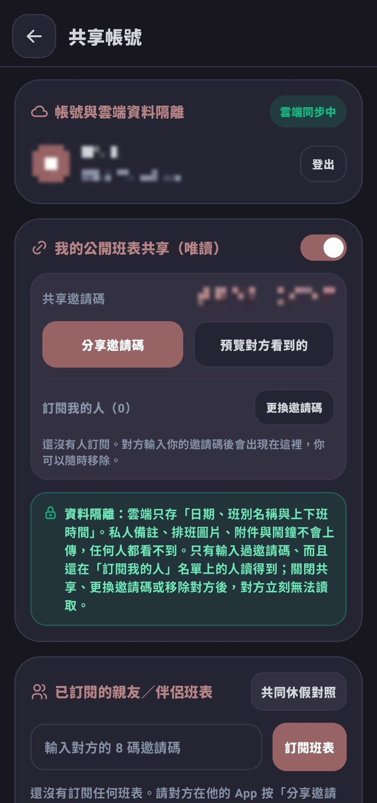
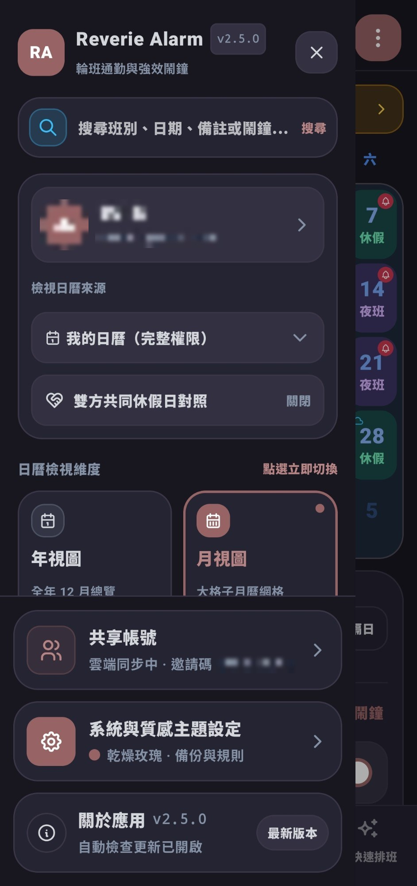

<div align="center">


# Reverie Alarm

<p>
  <a href="https://github.com/a097437/Reverie-Alarm/releases"></a>
  
  
  
  <a href="https://discord.gg/8Ym2QkWxAK"></a>
  <a href="https://afdian.com/a/a097437"></a>
  <a href="mailto:097437@gmail.com"></a>
</p>

融合 AI 快速排班與通勤族群設計的排班日曆與兩段式強效鬧鐘

<sub>排班日曆 · 輪班鬧鐘 · 國定假日 · 休假防呆 · Shift calendar &amp; alarm clock for Android</sub>

</div>

---

## 畫面預覽

<table>
  <tr>
    <td align="center"><br /><sub>排班日曆</sub></td>
    <td align="center"><br /><sub>兩段式鬧鐘</sub></td>
    <td align="center"><br /><sub>AI 快速排班</sub></td>
  </tr>
  <tr>
    <td align="center"><br /><sub>工具：天氣與通勤</sub></td>
    <td align="center"><br /><sub>共享帳號</sub></td>
    <td align="center"><br /><sub>側邊選單</sub></td>
  </tr>
</table>

---

## 核心能力

- **智慧排班日曆**：內建早班、晚班、夜班與休假模板，一鍵套用並掌握整月班表；月、週、日、年四種檢視，週／日視圖是 24 小時跨夜時間軸
- **兩段式強效鬧鐘**：依班別自動排好「起床提醒」與「出門倒數」，鎖屏、App 關閉、重開機後都會準時響鈴；出門倒數禁止貪睡
- **國定假日**：內建人事行政總處 2026–2027 年行事曆，可選「照班表上班」（輪班制）或「見紅就休」（一般上班族）
- **休假日鬧鐘防呆**：休假還開著上班鬧鐘會逐項提醒、可以復原；前一晚自動檢查，國定假日上班的鬧鐘絕對不會被誤關
- **AI 快速排班**：用聊的、用說的，或拍一張班表照片，就能排好整個月
- **桌面小工具**：2×2、4×2、兩週 5×2、整月 5×5 四種大小，不用打開 App 就看得到班表和下一個鬧鐘；兩週與整月可以翻頁
- **工具**：通勤天氣與帶傘提醒、碼錶、計時
- **自訂外觀**：18 種主題色、12 種日曆底色與色環調色盤，背景可以開啟會閃爍的小星星
- **各品牌手機都能準時**：鬧鐘可靠度檢查會依手機品牌直接打開背景執行設定，並附詳細教學
- **120Hz 流暢**：支援高更新率手機，滑月曆、切分頁都順；沒在操作時完全不重畫，省電
- **共享帳號**：用 8 碼邀請碼把班表唯讀分享給家人或伴侶，還能對照雙方共同休假日
- **離線完整運作**：班表與鬧鐘存在手機裡，沒有網路時也能查看班表、準時響鈴
- **中文／English**：介面可切換繁體中文或英文

---

## 更新內容

### v2.6.0

**新增特性**
- **桌面小工具一次四種**：2×2、4×2、兩週 5×2、整月 5×5。兩週和整月可以往前、往後翻頁，一段時間沒動會自動回到本週／本月；在「工具 → 小工具」預覽並一鍵加到桌面
- **自訂色彩**：主題色 18 種、日曆底色 12 種，自訂顏色改用色環調色盤
- **背景小星星**：設定裡可以開關、調整密度、換一批位置
- **鬧鐘可靠度檢查支援各品牌手機**：小米、華為、榮耀、OPPO、realme、OnePlus、vivo、三星、華碩、魅族、聯想，直接打開該品牌的背景執行設定並附教學
- **120Hz 高更新率**：支援高更新率的手機會使用最高 120Hz

**缺陷修護**
- 桌面小工具過了午夜還停在昨天
- 週視圖編輯班表後，時間軸上的色塊沒有更新
- 改完資料馬上離開 App 時，修改有機會沒存到
- 部分標題顯示成手機的 Emoji，現在統一用線條圖示

**體驗優化與調整**
- 左右滑月曆、切換分頁、碼錶與計時器、週視圖捲動都更順
- 沒在操作時畫面完全不重畫，螢幕可以自動降頻；背景星星沒碰手機一段時間就停止閃爍
- 讀取與存檔改在背景進行，開 App 更快
- 「⋮」選單移除桌面小工具捷徑，改從「工具 → 小工具」進入；側邊選單與「關於」改用 App 圖示

<details>
<summary><b>v2.5.0</b></summary>

- **國定假日**：2026、2027 年的國定假日與補假直接標在日曆上（紅字加假日名稱）。在側邊欄「國定假日」選你的上班方式：
  - **照班表上班**（保全、醫護、服務業等輪班制）：假日只標示，班表和鬧鐘完全照你排的
  - **見紅就休**（一般上班族）：沒排班的假日當放假；批次或 AI 排班會先略過假日，需要時一鍵加回。可選擇政府補假日要不要也放
  - 國定假日不會寫進班表，也不會自己改班或關鬧鐘；已經排好的班一律優先。側邊欄統計會顯示「國定假日上班幾天」，方便核對加倍工資
- **休假日鬧鐘防呆**：
  - 逐項勾選、每一項寫出原因，暫停後可以「復原」；只有「班改成休假，鬧鐘卻還開著」才會預設勾選，休假日自己設的鬧鐘只提醒
  - 鬧鐘看它屬於哪個班，不看哪天響：大夜班前一晚的起床鬧鐘不會因為那天是休假被誤關
  - **前一晚自動提醒**：每天晚上（預設 21:00，可選 20–23 點）檢查明天，有忘了關的上班鬧鐘、或明天有班卻沒鬧鐘才通知；通知上就能「暫停」「保留」，不用打開 App
- **工具分頁**：天氣、碼錶（計次）、計時、桌面小工具，切換有過渡動畫；碼錶和計時在通知列上也能暫停、計次、+1 分鐘
- **響鈴與鬧鐘**：響鈴畫面任意處往上滑就能關閉；鬧鐘分頁最上方顯示下一個鬧鐘還有多久響
- **AI 快速排班**：也能清除班表，例如「取消 25 號的夜班」
- **診斷日誌**：在「關於應用」可以匯出鬧鐘排程與響鈴紀錄，方便回報問題

</details>

<details>
<summary><b>v2.0.0</b></summary>

- **AI 快速排班**（下方最右邊的分頁）：用聊的、用說的，或拍一張紙本／公司公告的班表照片，Gemini 會找出你那一列並排好整個月。先預覽、確認後才套用，兩段式鬧鐘也會一起排好；哪裡不對可以直接跟它說，例如「15 號是夜班」
  - 登入 Google 帳號即可使用，不需要設定任何 API 金鑰（透過 Firebase AI Logic）
  - 沒登入也能用：手機上就能看懂「21 到 25 號早班」「下週一三五晚班」「這個月週六日休假，其他早班」這類說法，不會上傳
- **天氣分頁**：通勤天氣對照你的班表，顯示出門與下班時段的天氣和帶傘提醒；24 小時與 7 天預報、日出日落、紫外線，以及颱風、豪雨、強風等天氣特報。日曆格子也會顯示未來幾天的天氣小圖示
- **英文介面**：在「系統與質感主題設定」切換「跟隨系統／繁體中文／English」；Android 13 以上也能在系統設定裡切換
- **介面改版**：日曆格子顯示班別與天氣、鬧鐘清單用時間軸串起「起床 → 出門」、班別模板即時算出起床與出門時間、所有時間改用滾輪選擇
- **修正**：桌面小工具「載入視窗小工具時出現問題」

</details>

完整版本紀錄請見 [GitHub Releases](https://github.com/a097437/Reverie-Alarm/releases)

---

## 下載與使用

### 運行環境
- 作業系統：Android 8.0 以上（API 26+）
- 第一次開啟時請允許「通知」與「鬧鐘與提醒」權限，鬧鐘才會在鎖屏與省電模式下準時響
- 側邊欄的「鬧鐘權限檢查與測試」可以確認手機設定是否正確

### 安裝方式
- **GitHub Releases**：前往 [Releases 頁面](https://github.com/a097437/Reverie-Alarm/releases) 下載最新的 `.apk` 安裝檔
- 從之前任何版本升級都可以直接覆蓋安裝，班表、鬧鐘與設定都會保留

### 資料與隱私
- 班表、鬧鐘、備註、圖片與附件都存在手機裡，不登入也能完整使用
- 登入 Google 並打開共享後，雲端只存「日期、班別名稱與上下班時間」；私人備註、圖片、附件與鬧鐘不會上傳
- AI 快速排班只有在你按下送出時，才會把那一則文字或照片交給 Google Gemini 處理
- 天氣只送出地區經緯度；診斷日誌只存在手機裡，要你自己匯出才會離開手機

---

## 專案架構

```
Jetpack Compose UI（排班日曆、兩段鬧鐘、班別模板、工具、AI 快速排班）
       │
規則與資料層（班表、國定假日判斷、休假防呆、匯入驗證）
       │
原生鬧鐘引擎（AlarmManager 精準鬧鐘 → 前景響鈴服務 → 全螢幕響鈴畫面）
       │
Firebase（Google 登入、共享班表、AI Logic、App Check）
```

- **原生鬧鐘引擎**：使用系統精準鬧鐘（`setAlarmClock`），鎖屏、App 關閉、重開機後都會準時響鈴；支援貪睡上限、出門倒數禁止貪睡與漸進音量
- **國定假日與休假防呆**（`HolidayRules.kt`）：班表與國定假日分成兩層資料，每天的狀態只由一個函式判斷（有排班就以排班為準），規則用單元測試鎖住（`HolidayRulesTest`）。前一晚提醒在 App 沒開時直接讀寫手機裡的資料，App 開著時交給畫面處理，兩邊不會互相覆蓋
- **內建柔和鈴聲**：11 首授權明確的鋼琴、木吉他與八音盒音樂，可無縫循環、音量統一（處理工具：`tools/ringtones/make_tones.py`）
- **跟手月曆與分頁**：左右拖曳月曆即時預覽上／下個月，拖曳空白處切換 5 大分頁
- **流暢度（120Hz）**：每幀變動的值只在繪製／排版階段讀，日期格可跳過重組、5 個分頁一直組好；存檔與讀檔在背景執行（`AppPersistence.kt`），並附 App 自己的 Baseline Profile。用 `python tools/perf/measure.py month`（或 `tabs`、`idle`、`refresh`）透過 adb 量測每一幀
- **桌面小工具**：RemoteViews 實作四種大小（`ShiftWidget.kt`），日期格版面由 `tools/widgets/gen_widget_layouts.py` 產生；午夜自動更新、更新在背景執行緒進行
- **天氣**：預報來自 Open-Meteo（CC BY 4.0），特報來自國家災害防救科技中心 NCDR 公開資料
- **AI 快速排班（Firebase AI Logic）**：Gemini 的金鑰留在 Firebase，App 裡沒有任何 AI 金鑰

<details>
<summary><b>安全設計</b></summary>

- **AI 防濫用**：每天 30 次、照片 10 張、送出間隔 3 秒；每則文字 500 字、回覆長度有上限；只帶最近 10 輪對話與最新一張照片。系統指示要求 AI 只做排班，並把訊息與照片裡的文字當資料、不當指令
- **AI 輸出檢查**：只收今天前 60 天到後 400 天內的日期、一次最多 120 天、班別必須對得上自己的班別模板，而且一定要使用者看過預覽、按「套用」才會寫入
- **App Check**：已接上 Firebase App Check（正式版 Play Integrity，測試版偵錯提供者）。目前主控台是「未強制執行」，上架 Google Play 後再改成「強制執行」
- **存取控制**：見 `firestore.rules`。讀取別人的班表要同時符合「對方開著共享」「我在訂閱者名單上」「我用的邀請碼是對方目前的邀請碼」，只知道對方的 UID 讀不到；所有欄位都有型別與長度限制
- **登入**：Google 帳號登入（Credential Manager + Firebase Authentication），權限一律由 Firestore 安全規則在伺服器端檢查
- **XSS**：介面用 Jetpack Compose 顯示純文字，沒有 WebView，也不解析 HTML
- **匯入安全**（`ImportGuard`）：備份檔先完整驗證，全部沒問題才一次套用，失敗時原本的資料不動；附件與鈴聲只接受手機裡的檔案或內建鈴聲，匯入音樂時會確認真的是音訊檔

</details>

<details>
<summary><b>自行編譯</b></summary>

1. 用 Android Studio 開啟專案根目錄
2. 若要使用自己的 Firebase 專案：把下載的 `google-services.json` 放到 `app/`，執行 `python tools/firebase/gen_firebase_values.py`，並把 `firestore.rules` 發布到 Firestore
   - 要使用 AI 快速排班：在 Firebase 主控台 → **AI Logic** 按「開始使用」並選擇 **Gemini Developer API**。App 不是從 Play 商店安裝時，請在 **App Check → APIs** 把 Firebase AI Logic 設為 **Unenforced**
   - 測試版（debug／perfTest）使用 App Check 偵錯提供者：第一次開啟時 logcat 會印出偵錯權杖（搜尋 `DebugAppCheckProvider`），要把它加到 **App Check → 應用程式 → 管理偵錯權杖**
3. 選擇 Build Variant：`debug`（開發）或 `perfTest`（最佳化、可直接覆蓋 debug 版安裝）

> 簽名金鑰（`*.jks`、`*.keystore`）與 `local.properties` 已在 `.gitignore` 排除，請勿上傳。

</details>

---

## 贊助與支持

Reverie Alarm 由獨立開發者維護。如果它幫你準時起床、少遲到幾次，歡迎透過愛發電支持持續更新：

- **愛發電**：[afdian.com/a/a097437](https://afdian.com/a/a097437)

---

## 授權與致謝

- **國定假日資料**：行政院人事行政總處「政府行政機關辦公日曆表」（[政府資料開放平臺](https://data.gov.tw/dataset/14718)）
- **天氣資料**：[Open-Meteo](https://open-meteo.com)（CC BY 4.0）、國家災害防救科技中心 NCDR 公開資料
- **圖示資源**：[Tabler Icons](https://tabler.io/icons)（MIT）
- **AI 與雲端**：Google Gemini（Firebase AI Logic）、Firebase Authentication／Firestore

<details>
<summary><b>鈴聲音樂來源</b></summary>

以下 2 首依 [CC BY 4.0](https://creativecommons.org/licenses/by/4.0/) 授權使用，已剪輯成循環片段並調整音量（App 內「關於應用」也有標註）：

- 「破曉時分」："Dawn's Break" by Shane Ivers (https://www.silvermansound.com), CC BY 4.0
- 「鳥鳴晨光」："Wake up in the morning sun" by 東月 (https://dongnguyet.itch.io/morning-sun), CC BY 4.0

其餘 9 首為 CC0（公眾領域），免標註，出處供參考：

- 「晨空漫步」「鋼琴晨空」：*Morning Sky* by Centurion_of_war（[OpenGameArt](https://opengameart.org/node/179462)）
- 「微光粒子」：*First Light Particles* by Yoiyami（[OpenGameArt](https://opengameart.org/node/182244)）
- 「緩緩甦醒」：*The Budding of Consciousness* by Yoiyami（[OpenGameArt](https://opengameart.org/content/the-budding-of-consciousness-%E2%80%93-cc0-ambient-minimalist-theme-yoiyami-blue-series-%E2%80%93-no4)）
- 「草原微風」：*Sunset Plains* by Yoiyami（[OpenGameArt](https://opengameart.org/node/182253)）
- 「營火吉他」：*A Small Fire Will Do* by Trex0n（[OpenGameArt](https://opengameart.org/content/a-small-fire-will-do-calming-loop)）
- 「晨間吉他」：*Etirwer* by Kistol（[OpenGameArt](https://opengameart.org/content/etirwer)）
- 「清脆八音盒」：*Music Box Cute Tune* by Aureolus_Omicron（[OpenGameArt](https://opengameart.org/node/136996)）
- 「晨鈴琶音」：*Happy Lullaby* by cynicmusic（[OpenGameArt](https://opengameart.org/content/happy-lullaby-song17)）

</details>

---

## 交流與回饋

- **Discord 社群**：[discord.gg/8Ym2QkWxAK](https://discord.gg/8Ym2QkWxAK)
- **Email**：[097437@gmail.com](mailto:097437@gmail.com)
- **問題回報與建議**：提交至 [GitHub Issues](https://github.com/a097437/Reverie-Alarm/issues)
