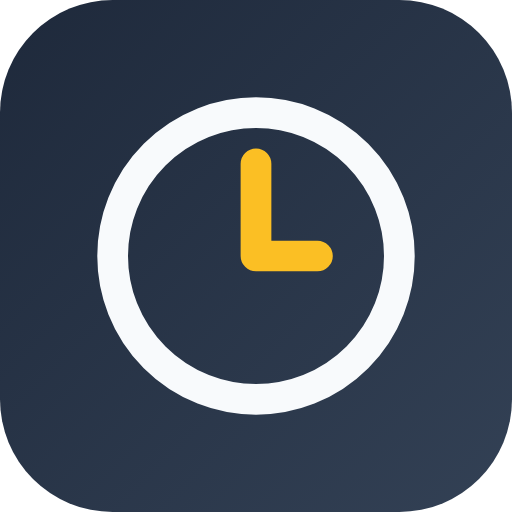

  

  <h1>Reverie Alarm</h1>

  

    
    
    
  

  
<strong>融合AI快速排班與通勤族群設計的日曆與兩段式強效鬧鐘應用</strong>

  
排班日曆 · 輪班鬧鐘 · 國定假日 · 休假防呆 · Shift calendar &amp; alarm clock for Android

---

### 核心功能

* **智慧排班日曆**：內建早班、晚班、夜班與休假模板，一鍵快速套用並掌握整月班表；月、週、日、年四種檢視，週／日視圖是 24 小時時間軸。
* **兩段式強效鬧鐘**：針對不同班別自動對應起床提醒與出門倒數，避免睡過頭。
* **國定假日**：內建人事行政總處 2026–2027 年行事曆，輪班族和一般上班族都適用。
* **休假日鬧鐘防呆**：休假還開著上班鬧鐘會提醒你，前一晚也會自動檢查；國定假日上班的鬧鐘絕對不會被誤關。
* **AI 快速排班**：用聊的、用說的，或拍一張班表照片，就能排好整個月。
* **工具**：天氣、碼錶、計時、桌面小工具。
* **離線完整運作**：班表與鬧鐘存在手機裡，沒有網路時也能查看班表、準時響鈴。
* **中文／English**：介面可切換繁體中文或英文。

### v2.5.0 新功能

* **國定假日**：2026、2027 年的國定假日與補假直接標在日曆上（紅字加假日名稱）。在側邊欄「國定假日」選你的上班方式：
  * **照班表上班**（保全、醫護、服務業等輪班制）：假日只標示，班表和鬧鐘完全照你排的。
  * **見紅就休**（一般上班族）：沒排班的假日當放假；批次或 AI 排班會先略過假日，需要時一鍵加回。可選擇政府補假日要不要也放。
  * 國定假日不會寫進班表，也不會自己改班或關鬧鐘；已經排好的班一律優先。側邊欄統計會顯示「國定假日上班幾天」，方便核對加倍工資。
* **休假日鬧鐘防呆**：
  * 逐項勾選、每一項寫出原因，暫停後可以「復原」；只有「班改成休假，鬧鐘卻還開著」才會預設勾選，休假日自己設的鬧鐘只提醒。
  * 鬧鐘看它屬於哪個班，不看哪天響：大夜班前一晚的起床鬧鐘不會因為那天是休假被誤關。
  * **前一晚自動提醒**：每天晚上（預設 21:00，可選 20–23 點）檢查明天，有忘了關的上班鬧鐘、或明天有班卻沒鬧鐘才通知；通知上就能「暫停」「保留」，不用打開 App。
* **工具分頁**：天氣、碼錶（計次）、計時、桌面小工具，切換有過渡動畫；碼錶和計時在通知列上也能暫停、計次、+1 分鐘。
* **響鈴與鬧鐘**：響鈴畫面任意處往上滑就能關閉；鬧鐘分頁最上方顯示下一個鬧鐘還有多久響。
* **AI 快速排班**：也能清除班表，例如「取消 25 號的夜班」。
* **診斷日誌**：在「關於應用」可以匯出鬧鐘排程與響鈴紀錄，方便回報問題。

### v2.0.0 新功能

* **AI 快速排班**（下方最右邊的分頁）：用聊的、用說的，或拍一張紙本／公司公告的班表照片，Gemini 會找出你那一列並排好整個月。先預覽、確認後才套用，兩段式鬧鐘也會一起排好；哪裡不對可以直接跟它說，例如「15 號是夜班」。
  * 登入 Google 帳號即可使用，不需要設定任何 API 金鑰（透過 Firebase AI Logic）。
  * 沒登入也能用：手機上就能看懂「21 到 25 號早班」「下週一三五晚班」「這個月週六日休假，其他早班」這類說法，不會上傳。
* **天氣分頁**：通勤天氣對照你的班表，顯示出門與下班時段的天氣和帶傘提醒；24 小時與 7 天預報、日出日落、紫外線，以及颱風、豪雨、強風等天氣特報。日曆格子也會顯示未來幾天的天氣小圖示。
* **英文介面**：在「系統與質感主題設定」切換「跟隨系統／繁體中文／English」；Android 13 以上也能在系統設定裡切換。
* **介面改版**：日曆格子顯示班別與天氣、鬧鐘清單用時間軸串起「起床 → 出門」、班別模板即時算出起床與出門時間、所有時間改用滾輪選擇；桌面小工具移到右上角「⋮」選單。
* **修正**：桌面小工具「載入視窗小工具時出現問題」。

### 下載與使用

* **Android APK 安裝**：前往 [Releases 頁面](https://github.com/a097437/Reverie-Alarm/releases) 下載最新版本的 `.apk` 安裝檔。

---

### 技術與架構（Kotlin + Jetpack Compose）

本儲存庫是 Reverie Alarm 的 Android 原生 App 原始碼（`app/`）。

**特色**

* **原生鬧鐘引擎**：使用系統精準鬧鐘，鎖屏、App 關閉、重開機後都會準時響鈴；支援貪睡上限與出門倒數禁止貪睡。
* **國定假日與休假防呆**（`HolidayRules.kt`）：班表與國定假日分成兩層資料，每天的狀態只由一個函式判斷（有排班就以排班為準），規則用單元測試鎖住（`HolidayRulesTest`）。前一晚提醒在 App 沒開時直接讀寫手機裡的資料，App 開著時交給畫面處理，兩邊不會互相覆蓋。
* **內建柔和鈴聲**：11 首授權明確（CC0／CC BY 4.0）的鋼琴、木吉他與八音盒音樂，可無縫循環、音量統一，不刺耳也不會忽大忽小（處理工具：`tools/ringtones/make_tones.py`）。
* **跟手月曆與分頁**：左右拖曳月曆即時預覽上／下個月，拖曳空白處切換 5 大分頁。
* **桌面小工具**：4×2 小工具顯示今日班表與下一個鬧鐘。
* **天氣**：預報來自 Open-Meteo（CC BY 4.0），特報來自國家災害防救科技中心 NCDR 公開資料；只送出地區經緯度。
* **AI 快速排班（Firebase AI Logic）**：Gemini 的金鑰留在 Firebase，App 裡沒有任何 AI 金鑰；只有使用者按下送出時，才會把該則文字或照片交給 Gemini。AI 回覆可以在 App 內回報。
* **共享帳號（Firebase）**：預設不共享；打開後產生 8 碼邀請碼，家人或伴侶輸入後可以看唯讀班表。看得到「誰訂閱了我」，可以個別移除或更換邀請碼。雲端只存日期、班別與上下班時間；私人備註、圖片、附件與鬧鐘不會上傳。

**安全設計**

* **AI 防濫用**：每天 30 次、照片 10 張、送出間隔 3 秒；每則文字 500 字、回覆長度有上限；只帶最近 10 輪對話與最新一張照片。系統指示要求 AI 只做排班，並把訊息與照片裡的文字當資料、不當指令。
* **AI 輸出檢查**：只收今天前 60 天到後 400 天內的日期、一次最多 120 天、班別必須對得上自己的班別模板，而且一定要使用者看過預覽、按「套用」才會寫入。
* **App Check**：已接上 Firebase App Check（正式版 Play Integrity，測試版偵錯提供者）。目前主控台是「未強制執行」，上架 Google Play 後再改成「強制執行」，才能擋住拆 APK 直接打 API 的人。
* **存取控制**：見 `firestore.rules`。班表只有訂閱者名單上的人讀得到，加入名單必須知道目前的邀請碼；所有欄位都有型別與長度限制。
* **存取控制（續）**：讀取別人的班表要同時符合「對方開著共享」「我在訂閱者名單上」「我用的邀請碼是對方目前的邀請碼」，只知道對方的 UID 讀不到；舊的 6 位數邀請碼一律查不到。
* **登入**：Google 帳號登入（Credential Manager + Firebase Authentication），權限一律由 Firestore 安全規則在伺服器端檢查。
* **XSS**：介面用 Jetpack Compose 顯示純文字，沒有 WebView，也不解析 HTML。
* **匯入安全**（`ImportGuard`）：備份檔先完整驗證、整理好，全部沒問題才一次套用，失敗時原本的資料不動；限制檔案大小、筆數與文字長度。附件與鈴聲只接受手機裡的檔案或內建鈴聲，擋掉指向 App 自身檔案的網址與網路網址；匯入音樂時會確認真的是音訊檔。

**鈴聲音樂來源**

以下 2 首依 [CC BY 4.0](https://creativecommons.org/licenses/by/4.0/) 授權使用，已剪輯成循環片段並調整音量（App 內「關於應用」也有標註）：

* 「破曉時分」："Dawn's Break" by Shane Ivers (https://www.silvermansound.com), CC BY 4.0
* 「鳥鳴晨光」："Wake up in the morning sun" by 東月 (https://dongnguyet.itch.io/morning-sun), CC BY 4.0

其餘 9 首為 CC0（公眾領域），免標註，出處供參考：

* 「晨空漫步」「鋼琴晨空」：*Morning Sky* by Centurion_of_war（[OpenGameArt](https://opengameart.org/node/179462)）
* 「微光粒子」：*First Light Particles* by Yoiyami（[OpenGameArt](https://opengameart.org/node/182244)）
* 「緩緩甦醒」：*The Budding of Consciousness* by Yoiyami（[OpenGameArt](https://opengameart.org/content/the-budding-of-consciousness-%E2%80%93-cc0-ambient-minimalist-theme-yoiyami-blue-series-%E2%80%93-no4)）
* 「草原微風」：*Sunset Plains* by Yoiyami（[OpenGameArt](https://opengameart.org/node/182253)）
* 「營火吉他」：*A Small Fire Will Do* by Trex0n（[OpenGameArt](https://opengameart.org/content/a-small-fire-will-do-calming-loop)）
* 「晨間吉他」：*Etirwer* by Kistol（[OpenGameArt](https://opengameart.org/content/etirwer)）
* 「清脆八音盒」：*Music Box Cute Tune* by Aureolus_Omicron（[OpenGameArt](https://opengameart.org/node/136996)）
* 「晨鈴琶音」：*Happy Lullaby* by cynicmusic（[OpenGameArt](https://opengameart.org/content/happy-lullaby-song17)）

**自行編譯**

1. 用 Android Studio 開啟專案根目錄。
2. 若要使用自己的 Firebase 專案：把下載的 `google-services.json` 放到 `app/`，執行 `python tools/firebase/gen_firebase_values.py`，並把 `firestore.rules` 發布到 Firestore。
   * 要使用 AI 快速排班：在 Firebase 主控台 → **AI Logic** 按「開始使用」並選擇 **Gemini Developer API**。App 不是從 Play 商店安裝時，請在 **App Check → APIs** 把 Firebase AI Logic 設為 **Unenforced**，否則請求會被擋下。
   * 測試版（debug／perfTest）使用 App Check 偵錯提供者：第一次開啟時 logcat 會印出偵錯權杖（搜尋 `DebugAppCheckProvider`），App Check 改成強制執行前，要把它加到 **App Check → 應用程式 → 管理偵錯權杖**。
3. 選擇 Build Variant：`debug`（開發）或 `perfTest`（最佳化、可直接覆蓋 debug 版安裝）。

> 簽名金鑰（`*.jks`、`*.keystore`）與 `local.properties` 已在 `.gitignore` 排除，請勿上傳。
